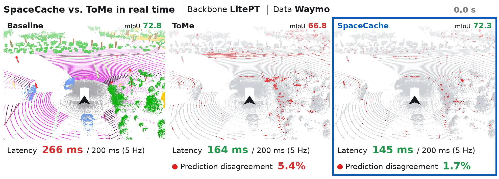
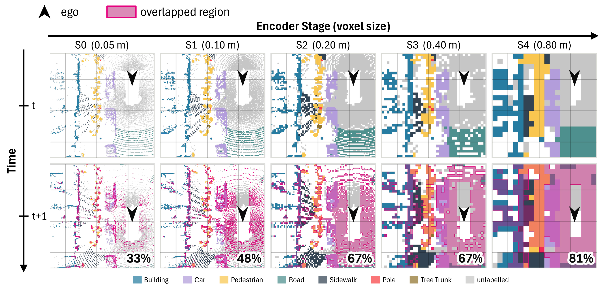
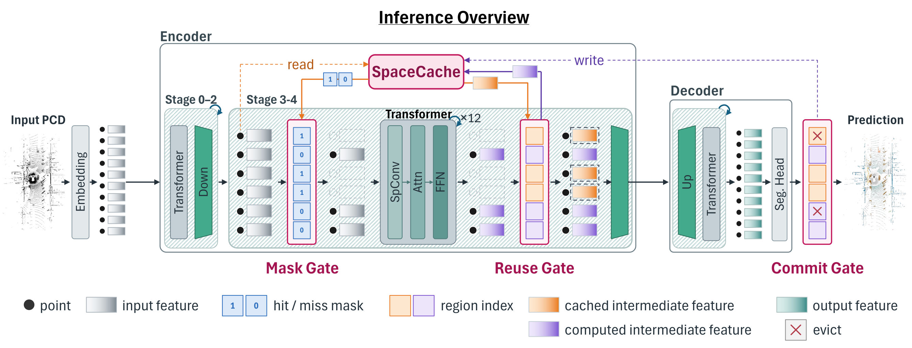
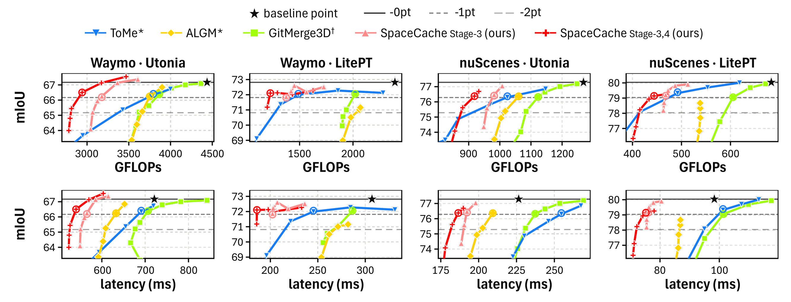

# SpaceCache: Intermediate Feature Reuse for Efficient Semantic Segmentation on Point Cloud Streams

Official implementation of **SpaceCache**.

[](https://arxiv.org/abs/2610.21207)
[](https://huggingface.co/honeydong49/SpaceCache)

<p align="center"></p>

LitePT-B on a 5 Hz Waymo stream (RTX A6000, FlashAttention). ToMe and
SpaceCache both keep up with the stream, but SpaceCache stays much closer to
the baseline's predictions.

## Overview

Point-cloud segmentation networks process every frame of a stream from
scratch, although consecutive frames largely overlap. The intermediate
features of point-cloud transformers stay semantically consistent across
frames for the same spatial region, especially in the deep stages.

<p align="center"></p>

SpaceCache is a training-free feature cache that reuses these features. It
adds no new parameters and keeps the full token layout for dense prediction.

<p align="center"></p>

**Tokens of previously observed regions skip the cached stage and take their
cached features; only the other tokens are computed.**

1. **Mask Gate:** maps each token to a region index in a global frame and looks it up in the cache (binary search over sorted keys).
2. **Reuse Gate:** after the stage's blocks run on the cache-miss tokens, restores the full token layout with the cached features.
3. **Commit Gate:** after the prediction, stores the new features and evicts invalid entries.
4. **Confidence filtering (θ):** entries whose region confidence is at most θ are not stored or are evicted.
5. **Lifetime (L):** every entry expires within L frames, staggered by region.

## Results

SpaceCache<sub>Stage-3,4</sub> at its fewest-FLOPs setting within a 1-point
mIoU drop (Table 1). Latency per frame on an RTX A6000.

| Backbone | Dataset | mIoU (%) | Latency (ms) | Speedup |
|---|---|---|---|---|
| Utonia | Waymo | 67.17 → 66.50 | 721 → 537 | **1.34×** |
| Utonia | nuScenes | 77.29 → 76.38 | 226 → 187 | **1.21×** |
| LitePT-B | Waymo | 72.82 → 72.11 | 307 → 186 | **1.65×** |
| LitePT-B | nuScenes | 80.04 → 79.14 | 98 → 75 | **1.31×** |

On the ScanNet video stream on a Jetson AGX Orin, SpaceCache<sub>Stage-3</sub>
cuts the kernel time of LitePT-B from 43.3 to 36.8 ms (1.18×) within a
1-point drop (Table 2).

<p align="center"></p>

mIoU against total GFLOPs (top) and latency (bottom) for SpaceCache, ToMe,
ALGM and GitMerge3D (Fig. 6). The ringed point of each curve is the setting
reported in Table 1.

## Installation

```bash
git clone https://github.com/YangDongHeon/SpaceCache.git && cd SpaceCache
conda env create -f environment.yml && conda activate pointcept-torch2.5.0-cu12.4
cd libs/pointops && python setup.py install && cd ../..
cd libs/pointrope && python setup.py install && cd ../..   # LitePT RoPE kernel (LitePT is slower without it)
```

Tested with Python 3.10, PyTorch 2.5 and CUDA 12.4.

## Checkpoints

We provide Utonia and LitePT-B checkpoints for Waymo, nuScenes and ScanNet.
This command downloads all six into `exp/`, where the evaluation configs
load them:

```bash
huggingface-cli download honeydong49/SpaceCache --include "exp/*" --local-dir .
```

<details>
<summary>Checkpoint paths</summary>

| Dataset | Backbone | Checkpoint |
|---|---|---|
| Waymo | Utonia | `exp/utonia/semseg-utonia-v1m1-5b-waymo-dec/model/model_best.pth` |
| Waymo | LitePT-B | `exp/litept/waymo/semseg-litept-v1m1-0-base/model/model_best.pth` |
| nuScenes | Utonia | `exp/utonia/semseg-utonia-v1m1-4b-nuscenes-dec/model/model_best.pth` |
| nuScenes | LitePT-B | `exp/litept/nuscenes/semseg-litept-v1m1-0-base/model/model_best.pth` |
| ScanNet | Utonia | `exp/utonia/semseg-utonia-v1m1-0b-scannet-dec/model/model_best.pth` |
| ScanNet | LitePT-B | `exp/litept/scannet/semseg-litept-v1m1-0-base/model/model_best.pth` |

</details>

## Data

Download [Waymo](https://github.com/Pointcept/Pointcept#waymo) (v1.4.3),
[nuScenes](https://github.com/Pointcept/Pointcept#nuscenes) (with lidarseg)
and [ScanNet v2](https://github.com/Pointcept/Pointcept#scannet-v2) as
described in the Pointcept README, and place the preprocessed ScanNet
scenes from Pointcept at `data/scannet`. Then preprocess the rest:

```bash
bash scripts/prepare_data.sh waymo    /path/to/waymo
bash scripts/prepare_data.sh nuscenes /path/to/nuscenes
bash scripts/prepare_data.sh scannet  /path/to/scannet   # RGB-D videos -> data/scannetvideo
```

<details>
<summary>Preprocessing environment</summary>

Preprocessing runs in its own environment, since the Waymo reader needs
TensorFlow:

```bash
conda env create -f environment-data.yml && conda activate spacecache-data
pip install waymo-open-dataset-tf-2-12-0 protobuf==3.20.3   # Waymo only; x86_64 Linux
```

</details>

<details>
<summary>Waymo latency subset only (10 segments)</summary>

To try SpaceCache without the full dataset, download only the 10 Waymo
segments used for latency (about 1.4 GB after preprocessing). They run every
Waymo latency and ablation experiment; the mIoU of the paper needs the full
validation split.

```bash
# needs a Waymo Open Dataset account and gsutil
bash scripts/reproduce/download_waymo_slice.sh /path/to/waymo
bash scripts/prepare_data.sh waymo /path/to/waymo
```

</details>

<details>
<summary>ScanNet video</summary>

Each frame of the stream is one RGB-D frame of a validation scene,
back-projected into a point cloud at 3 Hz. `prepare_data.sh scannet` builds
it from the `.sens` and `_2d-label-filt.zip` files of the 20 scenes listed in
`scripts/reproduce/prepare_scannet_video.sh`, downloaded with the ScanNet
download script into `/path/to/scannet/scans/<scene>/`.

</details>

## Quick start

Check the setup on the first 20 Waymo validation frames, for the backbone,
SpaceCache and the three baselines:

```bash
bash scripts/reproduce/smoke_test.sh
```

A single run evaluates one method on one config:

```bash
PYTHONPATH=. python spacecache/experiments/run.py \
    --config spacecache/configs/waymo/utonia_dec/latency_slice.py \
    --policy spacecache_s34 --lifetime 8 --confidence 0.85
```

The config selects the data and the checkpoint
(`spacecache/configs/<dataset>/<backbone>[/<slice>].py`); the method and its
settings are flags. The paper uses L = 8 outdoors and 4 on ScanNet, and
sweeps θ and the baseline settings over the values of Appendix Table 5.

| Method | `--policy` | Setting |
|---|---|---|
| Backbone | `backbone` | |
| SpaceCache<sub>Stage-3</sub> | `spacecache_s3` | `--confidence` θ, `--lifetime` L |
| SpaceCache<sub>Stage-3,4</sub> | `spacecache_s34` | same |
| ToMe | `tome` | `--merge_ratio` r |
| ALGM | `algm` | `--algm_tau` τ |
| GitMerge3D | `gitmerge3d` | `--merge_ratio` r |

## Reproducing the paper

One script per table or figure:

```bash
# Table 1, Fig. 6: outdoor comparison (RTX A6000)
bash scripts/reproduce/outdoor_accuracy.sh                # all GPUs
bash scripts/reproduce/outdoor_latency.sh --gpus 0,1      # or only GPUs 0 and 1
bash scripts/reproduce/outdoor_tables.sh

# Table 2: indoor comparison
bash scripts/reproduce/indoor_accuracy.sh --gpus 2
bash scripts/reproduce/indoor_latency_orin.sh             # on the Jetson AGX Orin

# Tables 3, 4, 6 and Figs. 2, 5, 7: ablations and analysis (Waymo, Utonia)
bash scripts/reproduce/ablation.sh              # Table 3
bash scripts/reproduce/gitmerge3d_adaptive.sh   # Table 4 (Orin column: add `orin` on the Orin)
bash scripts/reproduce/motivation.sh            # Fig. 2
bash scripts/reproduce/reuse_agreement.sh       # Fig. 5 (after motivation.sh)
bash scripts/reproduce/efficiency.sh            # Table 6, Fig. 7 (after Table 1)
```

The sweeps run exactly the values of Appendix Table 5.

## Evaluation

### Evaluation data

| Dataset | mIoU | Latency | GFLOPs | Peak memory |
|---|---|---|---|---|
| Waymo | validation split (5,976 frames) | 10 segments (299 frames), RTX A6000 | 10 segments | 10 segments |
| nuScenes | validation split (6,019 frames) | 8 scenes (321 frames), RTX A6000 | 8 scenes | 8 scenes |
| ScanNet video | 10 validation scenes (2,221 frames) | 2 scenes (395 frames), Jetson AGX Orin (kernel time) | 10 validation scenes | – |

### Metrics

| Metric | Definition |
|---|---|
| mIoU | single forward pass, no test-time augmentation |
| Latency | ms per frame |
| GFLOPs | total FLOPs per frame |
| Peak memory | mean per-frame peak GPU memory |
| Kernel time | summed GPU kernel time per frame |

<details>
<summary>Reproducing the outdoor SpaceCache numbers exactly</summary>

When several tokens of a frame fall into the same region, the code averages
their features into one entry. The outdoor SpaceCache numbers of the paper
instead kept one entry per token and served the first; set
`SPACECACHE_KEYS_UNIQUE=1` to reproduce them. The default scores slightly
higher (+0.07 to +0.15 mIoU on the Table 1 points we re-ran).

</details>

## Training

<details>
<summary>Train the six checkpoints yourself</summary>

The Utonia checkpoints train only the segmentation decoder; the encoder is
the released Utonia model, kept fixed. Place its weights
([`utonia.pth`](https://huggingface.co/Pointcept/Utonia)) at
`weights/utonia.pth` and run (all GPUs by default):

```bash
sh scripts/train.sh -d utonia -c semseg-utonia-v1m1-5b-waymo-dec    -n semseg-utonia-v1m1-5b-waymo-dec    -w weights/utonia.pth
sh scripts/train.sh -d utonia -c semseg-utonia-v1m1-4b-nuscenes-dec -n semseg-utonia-v1m1-4b-nuscenes-dec -w weights/utonia.pth
sh scripts/train.sh -d utonia -c semseg-utonia-v1m1-0b-scannet-dec  -n semseg-utonia-v1m1-0b-scannet-dec  -w weights/utonia.pth
sh scripts/train.sh -d waymo    -c semseg-litept-v1m1-0-base -e exp/litept/waymo/semseg-litept-v1m1-0-base
sh scripts/train.sh -d nuscenes -c semseg-litept-v1m1-0-base -e exp/litept/nuscenes/semseg-litept-v1m1-0-base
sh scripts/train.sh -d scannet  -c semseg-litept-v1m1-0-base -e exp/litept/scannet/semseg-litept-v1m1-0-base
```

</details>

## Repository layout

```
SpaceCache/
├── spacecache/
│   ├── policies/       # SpaceCache, ToMe, ALGM, GitMerge3D
│   ├── common/         # cache table, region index, Triton kernels, profiling
│   ├── experiments/    # evaluation (run.py) and table builders
│   ├── figure/         # figure scripts
│   ├── demo/           # streaming demo above (dump, render)
│   └── configs/        # evaluation configs
├── pointcept/          # backbones (Utonia, LitePT), datasets, preprocessing
├── configs/            # training configs
├── libs/               # CUDA ops (pointops, pointrope)
├── scripts/
│   ├── reproduce/      # one script per table or figure
│   └── train.sh
└── tools/              # training and testing entry points
```

## License

| Component | License |
|---|---|
| Code | MIT (`LICENSE`); the GitMerge3D matching and attention code in `spacecache/common/{token_merging_algos,tome_attention}.py` is adapted from [GitMerge3D](https://github.com/anhtuanhsgs/GitMerge3D) (MIT) |
| Utonia checkpoints | derived from the [Utonia](https://huggingface.co/Pointcept/Utonia) weights, CC BY-NC 4.0, and the terms of the dataset they were trained on |
| Waymo checkpoints | [Waymo Dataset License Agreement for Non-Commercial Use](https://waymo.com/open/terms) |
| nuScenes checkpoints | CC BY-NC-SA 4.0, [nuScenes terms of use](https://www.nuscenes.org/terms-of-use) |
| ScanNet checkpoints | [ScanNet Terms of Use](http://kaldir.vc.in.tum.de/scannet/ScanNet_TOS.pdf) |

The checkpoints trained on Waymo, and all Utonia checkpoints (the Utonia
encoder was pretrained partly on Waymo), were made using the Waymo Open Dataset,
provided by Waymo LLC under the Waymo Dataset License Agreement for
Non-Commercial Use, available at waymo.com/open/terms, and your access and use
of such work are governed by the terms and conditions therein. They are
released under that agreement; any further downstream use or modification of
them is subject to its terms, including the non-commercial restrictions of its
Section 4. They must not be used to operate or assist the operation of a
vehicle, in production systems, or for other primarily commercial purposes.

## Citation

```bibtex
@article{yang2026spacecache,
  title   = {SpaceCache: Intermediate Feature Reuse for Efficient Semantic Segmentation on Point Cloud Streams},
  author  = {Yang, Dongheon and Kang, Beomseok and Kim, Jae-Joon},
  journal = {arXiv preprint arXiv:2610.21207},
  year    = {2026}
}
```

This code builds on [Pointcept](https://github.com/Pointcept/Pointcept),
including its Point Transformer V3, Utonia and LitePT implementations, and
reimplements ToMe, ALGM and GitMerge3D as baselines.
